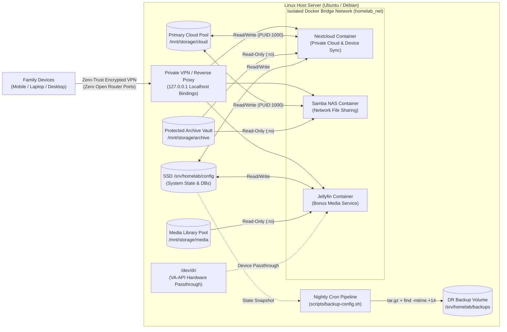

# Self-Hosted Private Cloud & Backup Homelab (`homelab-docker-infra`)

[](./docker-compose.yml)
[](./docker-compose.yml)
[](./scripts/backup-config.sh)
[-2ea44f)](#3-the-build-arc--security-design-decisions)
[](./docker-compose.yml)

> **Executive Summary:** Declarative Infrastructure-as-Code (IaC) repository for a **self-hosted Linux private cloud storage, NAS file-sharing, and automated disaster-recovery homelab**. Built to give my family a zero-subscription private cloud to automatically sync and back up important files, documents, and photos from anywhere with full data sovereignty—operated like an enterprise Linux environment with isolated Docker bridge networking (`homelab_net`), strict `PUID`/`PGID` least-privilege user mapping, read-only (`:ro`) volume protection, automated nightly `.tar.gz` backups with 14-day rolling retention, zero-trust VPN access (zero open router ports), and local media streaming with `/dev/dri` VA-API hardware passthrough as a bonus household service.

---

## 1. Motivation & Engineering Goals

- **The Problem (Data Sovereignty & Cloud Subscription Sprawl):** Consumer cloud storage tiers impose recurring monthly costs and require handing personal family documents, photos, and device backups over to third-party providers.
- **The Objective:** Engineer a reliable, self-hosted Linux server that operates like an enterprise environment—reproducible from a single declarative configuration, backed by automated disaster recovery, and locked down behind a zero-trust private network gateway.
- **Hands-On Systems Philosophy:** When studying AWS cloud architecture or Linux systems administration, I don't stop at theory—I build, harden, and operate the infrastructure 24/7 at home.

---

## 2. System Architecture



---

## 3. The Build Arc & Security Design Decisions

### Beat 1 — Private Cloud Storage & Network-Attached File Sharing
- **Containerized Private Cloud (`nextcloud`):** Provides automated mobile and desktop synchronization for family documents, photos, and important files from anywhere over an encrypted connection.
- **Network-Attached Storage (`samba-nas`):** Exposes high-throughput SMB network shares over the private LAN/VPN so household machines can mount storage pools natively.
- **Declarative Reproducibility (`docker-compose.yml`):** Entire multi-service stack is defined as code on Linux, enabling the server to be rebuilt on any Linux machine with a single command.

### Beat 2 — Automated Disaster Recovery (`scripts/backup-config.sh`)
- **Nightly Compressed State Snapshots (`tar.gz`):** A scheduled Bash cron job archives `/srv/homelab/config` (application state, metadata, and databases) into UTC-timestamped `homelab-state-<timestamp>.tar.gz` bundles.
- **Automated 14-Day Rolling Retention (`find -mtime +14`):** Automatically prunes backup archives older than 14 days (`find "${BACKUP_ROOT}" -maxdepth 1 -type f -name "homelab-state-*.tar.gz" -mtime +14 -delete`) so backup storage never fills up.
- **CI Validation (`workflows/validate.yml`):** Validated via GitHub Actions running `docker compose config --quiet` schema checks and `ShellCheck` static analysis on all Bash automation scripts.

### Beat 3 — Defense-in-Depth Security & Bonus Household Services
- **Zero-Trust Private Networking (Zero Open Router Ports):** All container ports bind strictly to `127.0.0.1` inside an isolated Docker bridge network (`homelab_net`) behind an encrypted VPN/reverse-proxy gateway—no ports are exposed to the public internet.
- **Least-Privilege User Mapping (`PUID` / `PGID`):** Containers execute under an unprivileged host user (`PUID=1000`, `PGID=1000`), preventing root-owned file artifacts on host storage pools.
- **Immutable Read-Only Volume Locks (`:ro`):** Long-term archive vaults (`/mnt/archive:ro`) and media pools (`/data/tvshows:ro`, `/data/movies:ro`) are mounted with strict `:ro` flags so container processes cannot modify, encrypt, or delete underlying host files.
- **Bonus Household Service — Hardware-Accelerated Media Streaming (`jellyfin`):** Runs alongside the private cloud as a secondary service, passing through `/dev/dri` (Linux Direct Rendering Manager) for VA-API / Intel QuickSync hardware transcoding without taxing CPU resources reserved for cloud storage.

---

## 4. Repository Structure

```text
homelab-docker-infra/
├── .github/workflows/
│   └── validate.yml          # CI pipeline: `docker compose config` & ShellCheck linting
├── workflows/
│   └── validate.yml          # Mirrored workflow definition for reference
├── scripts/
│   └── backup-config.sh      # Nightly tar.gz state snapshot + 14-day retention rotation
├── .env.example              # Sanitized environment template (PUID/PGID, Cloud & Backup paths)
├── .gitignore                # Prevents committing .env secrets or runtime state
├── docker-compose.yml        # Declarative Nextcloud, Samba NAS & Jellyfin stack
└── README.md                 # Architecture documentation & disaster recovery runbook
```

---

## 5. Single-Command Rebuild & Deployment Runbook

```bash
# 1. Clone the repository on any Linux host
git clone https://github.com/Shadz11/homelab-docker-infra.git
cd homelab-docker-infra

# 2. Configure host storage paths & PUID/PGID mapping
cp .env.example .env
nano .env

# 3. Validate declarative schema & launch the private cloud stack
docker compose config --quiet
docker compose up -d

# 4. Verify container healthchecks
docker compose ps

# 5. Install nightly disaster-recovery cron job (03:15 AM daily, 14-day retention)
chmod +x scripts/backup-config.sh
(crontab -l 2>/dev/null; echo "15 3 * * * $(pwd)/scripts/backup-config.sh >> /var/log/homelab-backup.log 2>&1") | crontab -
```

---

## Author
**Shadabul Hoque**  
B.Sc. Computer Science (UNSW Sydney) · Systems, Cloud & Automation  
Portfolio: [shadabulhoque.vercel.app](https://shadabulhoque.vercel.app)
